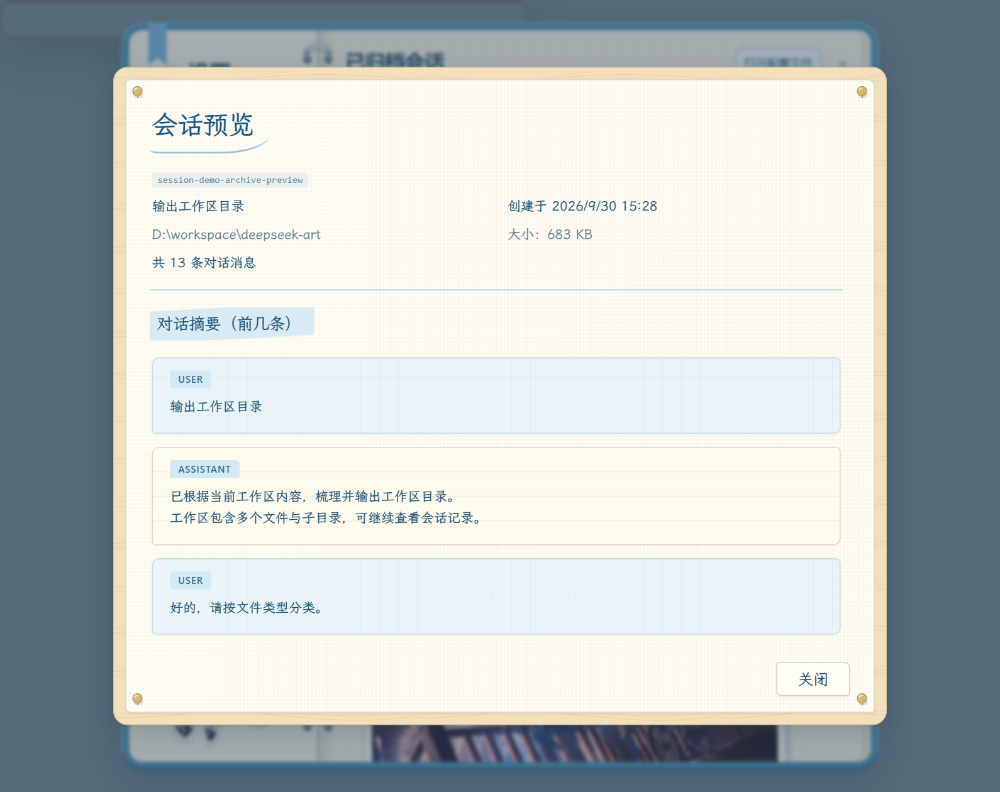

# After-School Squad Journal

[中文](README.md) · **English** · [日本語](README.ja.md)

### 放課後小队手账本

**Keep a little of the after-school sunshine on every page.**

> **Permission pending · Design showcase for artist review**

A journal-style skin concept for DeepSeek Harness, prepared so **Koe@寝不足** can review how the illustrations appear in the interface. Blue graph paper, binder rings, paper tabs and washi tape connect conversations and settings like pages in a journal.

This is a personal, non-commercial design prototype. Permission to use the illustrations has not yet been confirmed. This repository contains previews, descriptions and source links; it does not distribute the complete skin, an installer or standalone original artwork. It is not an official collaboration with the artist or DeepSeek.

## 01 · Main interface

《UNOタイム》 sits inside a photo-style frame. Conversations resemble index cards, while the composer becomes a blue graph-paper note, connected by tabs, tape and layered paper edges.

> The main interface is reconstructed using the current skin styles and a demo layout. Conversations, account details and usage figures are demonstration data.

## 02 · Everyday moments in Settings

Each illustration sits beneath the settings content, alongside navigation, controls and journal decorations. Click any screenshot to view it at full size.

> These simulated pages use the existing skin styles and representative settings controls. The normally scrollable content is expanded vertically so the controls and artwork can be seen together. They are not unaltered screenshots of the running application. UI text in the screenshots remains in Chinese.

<table>
<tr>
<td width="50%" valign="top">
<h3>General</h3>

Icy blue photo paper, six-armed snowflakes and a little snowman wearing a scarf.

</td>
<td width="50%" valign="top">
<h3>Models</h3>

Green tape, watermelon and a seed packet.

</td>
</tr>
<tr>
<td width="50%" valign="top">
<h3>Built-in plugins</h3>

Gingham cloth, a menu and tableware.

</td>
<td width="50%" valign="top">
<h3>Agent presets</h3>

Constellations, an envelope and a gold seal.

</td>
</tr>
<tr>
<td width="50%" valign="top">
<h3>Archived conversations</h3>

Night-sky tape, fireworks and a festival ticket.

</td>
<td width="50%" valign="top">
<h3>Pets</h3>

A paper clip, blue note and lemon soda.

</td>
</tr>
<tr>
<td width="50%" valign="top">
<h3>Account and balance</h3>

A cinema group photo, ticket and after-school journal label.

</td>
<td width="50%" valign="top">
<h3>Usage statistics</h3>

Dawn and dusk photos with blue and orange gingham tape.

</td>
</tr>
<tr>
<td width="50%" valign="top">
<h3>Web plugins</h3>

Blue and orange striped tape, a lunch note and a milk-carton doodle.

</td>
<td></td>
</tr>
</table>

Titles and artist credits appear on the photo borders; links to the full original works are below.

### Conversation preview · Wood and canvas

Ivory canvas on a pale wooden board, secured by four thumbtacks, with graph-paper and ruled-paper messages.

## Illustrations and production credits

The illustrations and the chibi character sticker at the lower left are works by **Koe@寝不足**. Illustration sources are listed below (from Pixiv and the artist’s X posts). Artist profiles: [Pixiv](https://www.pixiv.net/users/3063728/artworks) · [X](https://x.com/Koe_Nemu); the chibi sticker comes from the artist’s [Bilibili post](https://www.bilibili.com/opus/938087270536183840). Paper, tape, UI icons and soda decorations were produced for this project, partly with AI assistance. These surrounding decorations are not part of the artist’s original works.

| Placement | Original work |
| --- | --- |
| Main interface | [UNOタイム](https://www.pixiv.net/artworks/121190180) |
| General | [雪合戦❄](https://www.pixiv.net/artworks/139476242) |
| Models | [夏が懐かしくなった](https://www.pixiv.net/artworks/118909853) |
| Built-in plugins | [すき焼きタイム](https://www.pixiv.net/artworks/118880991) |
| Agent presets | [星の手紙🌟](https://www.pixiv.net/artworks/118816328) |
| Archived conversations | [夏が終わる前に](https://www.pixiv.net/artworks/139476059) |
| Pets | [夏の気配](https://www.pixiv.net/artworks/98313271) |
| Account and balance | [シネマ🎬](https://x.com/Koe_Nemu/status/1793287183694217506) |
| Usage statistics | [Two railing illustrations (display labels: Dawn / Dusk)](https://x.com/Koe_Nemu/status/1793653257379950875) |
| Web plugins | [唐揚げを食べたい気分🍗](https://x.com/Koe_Nemu/status/1792194921761579318/photo/1) |
| Lower-left corner of Settings | [Chibi character sticker](https://www.bilibili.com/opus/938087270536183840) |

## Permission status

Illustration rights remain with the artist and the respective rights holders. Public display and attribution do not establish permission to use or redistribute the artwork, nor do they grant viewers a license to use it. The permitted scope must be confirmed separately before releasing the complete skin.

[中文](README.md) · **English** · [日本語](README.ja.md)

Showcase prepared by：**[Alphazerolan](https://github.com/Alphazerolan)** · 2026-10-17
