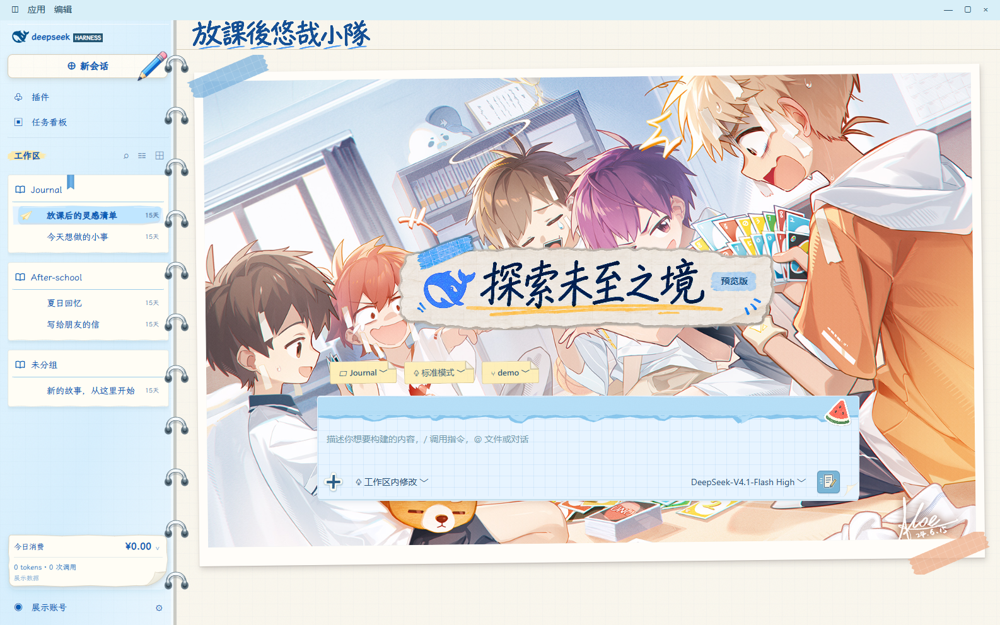
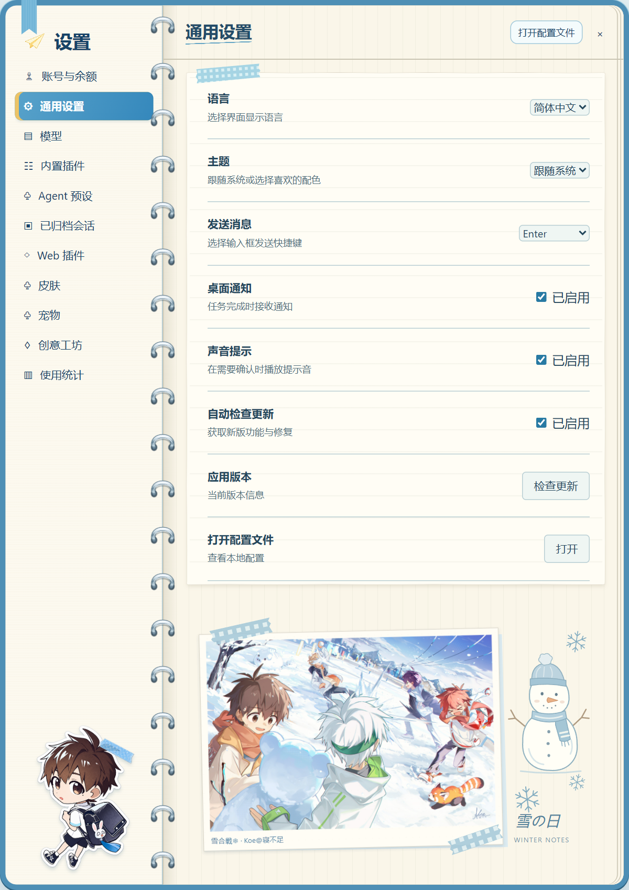
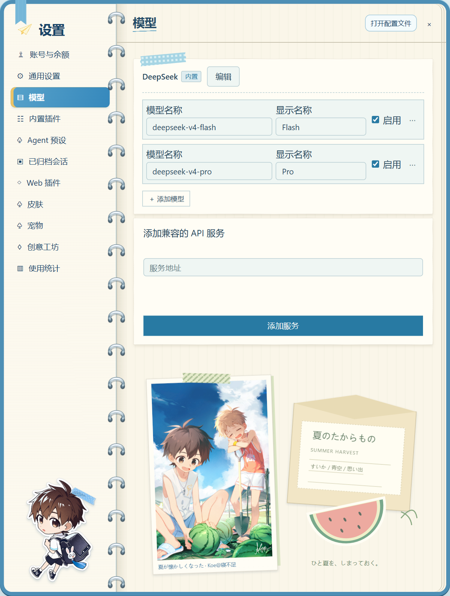
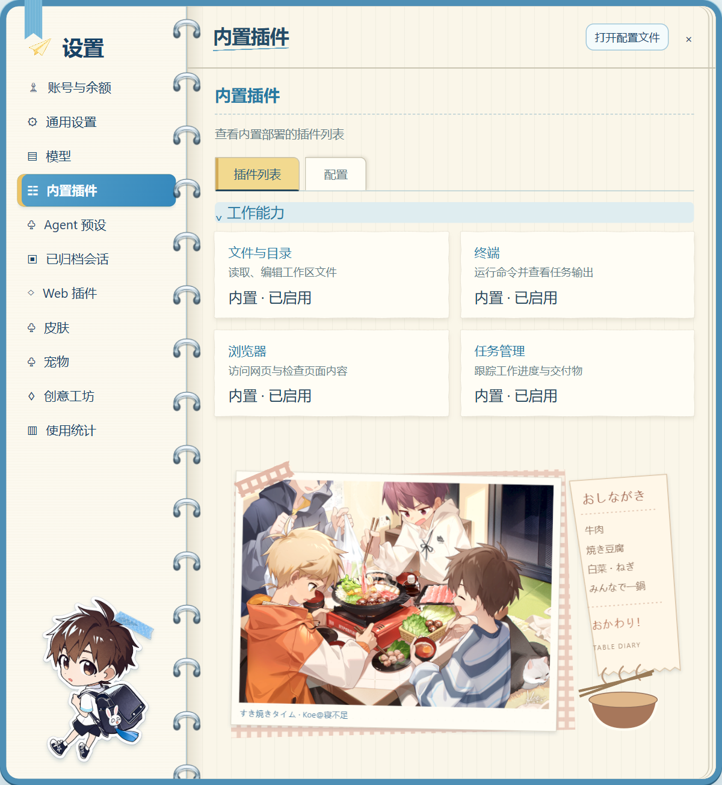
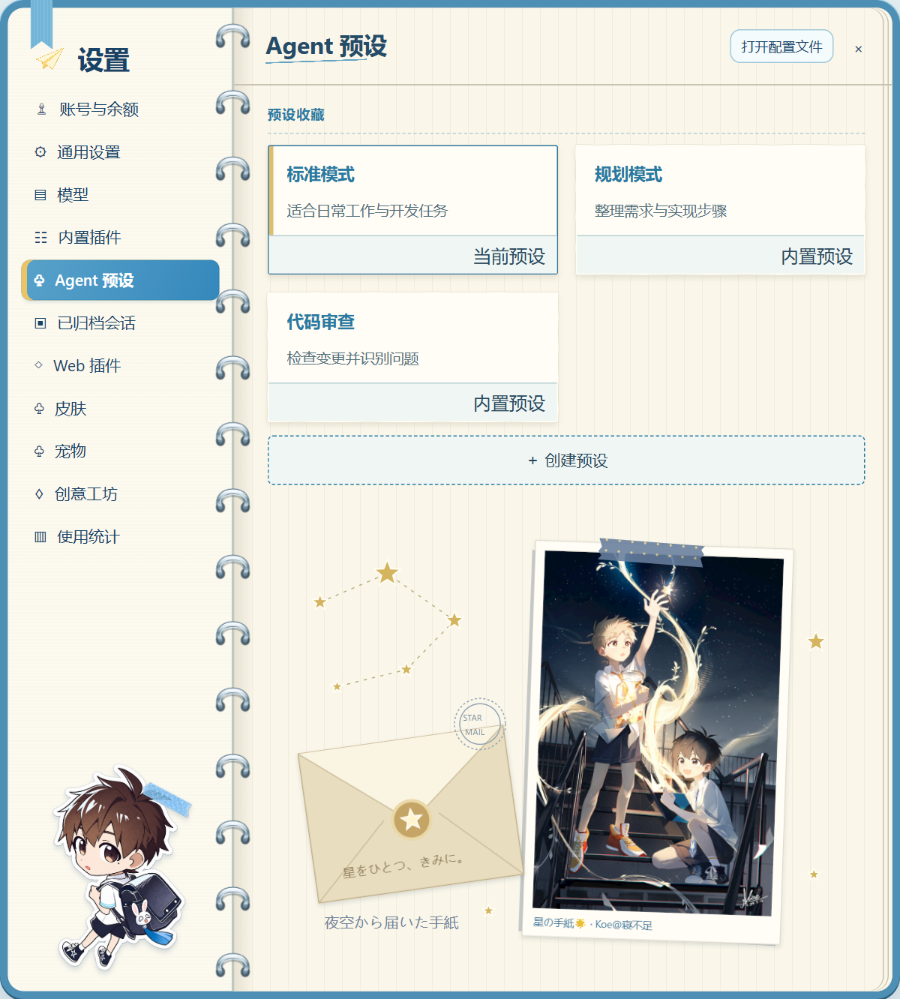
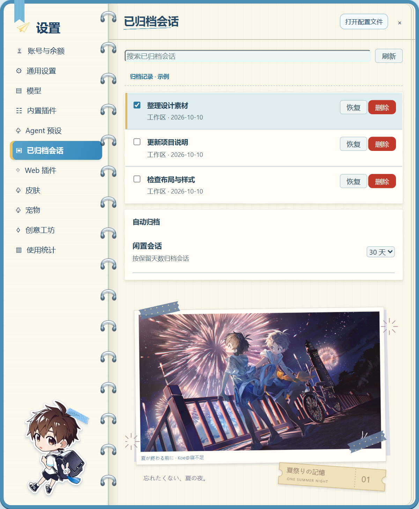
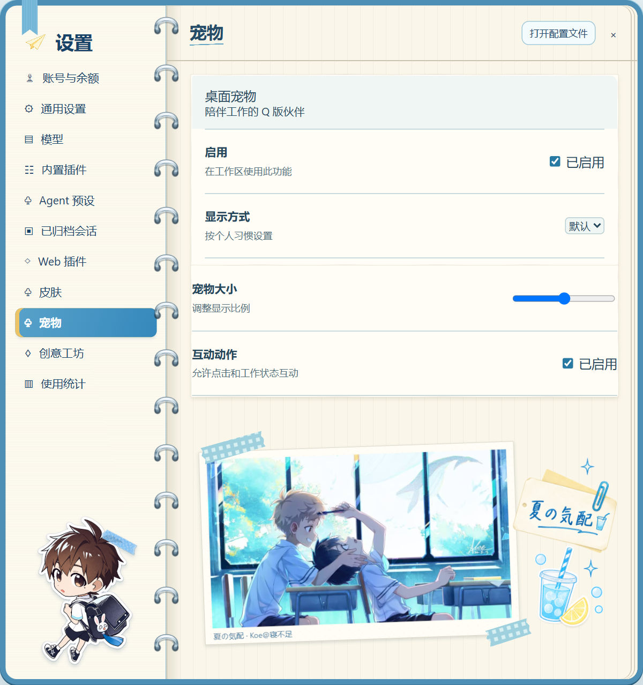
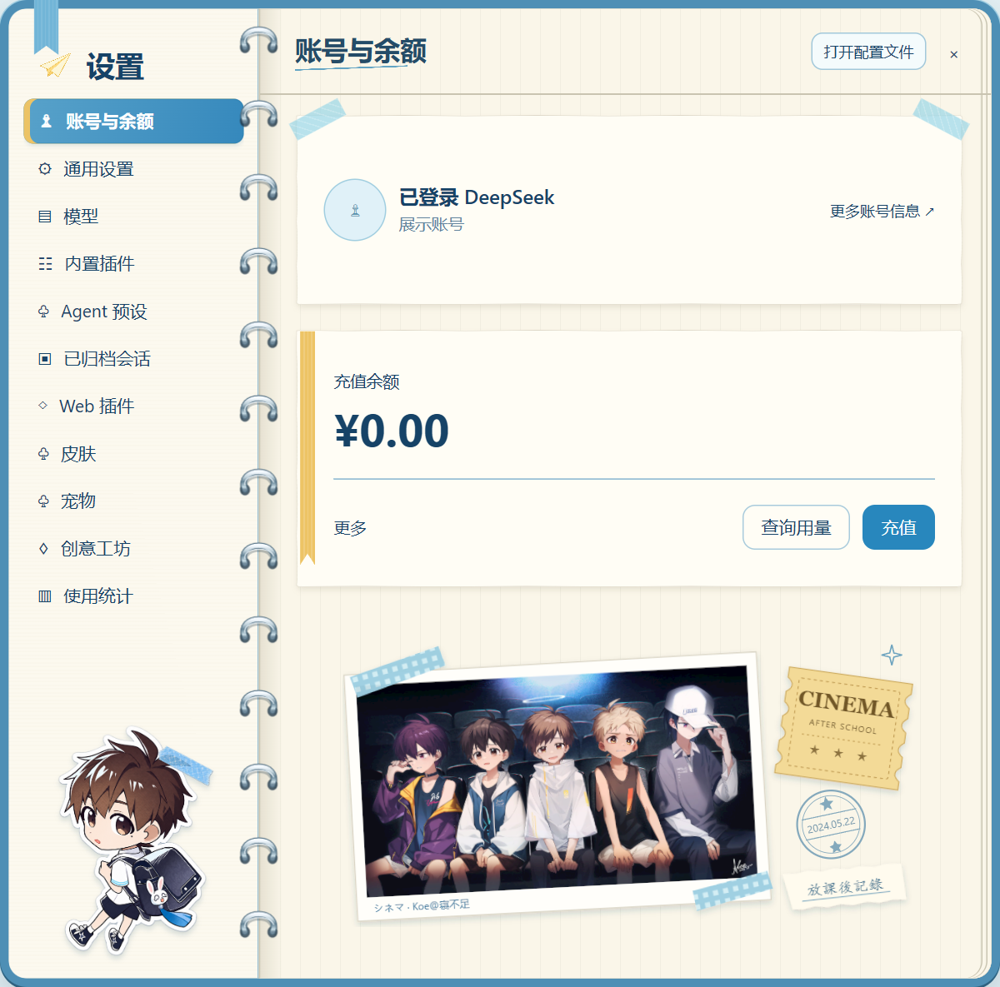
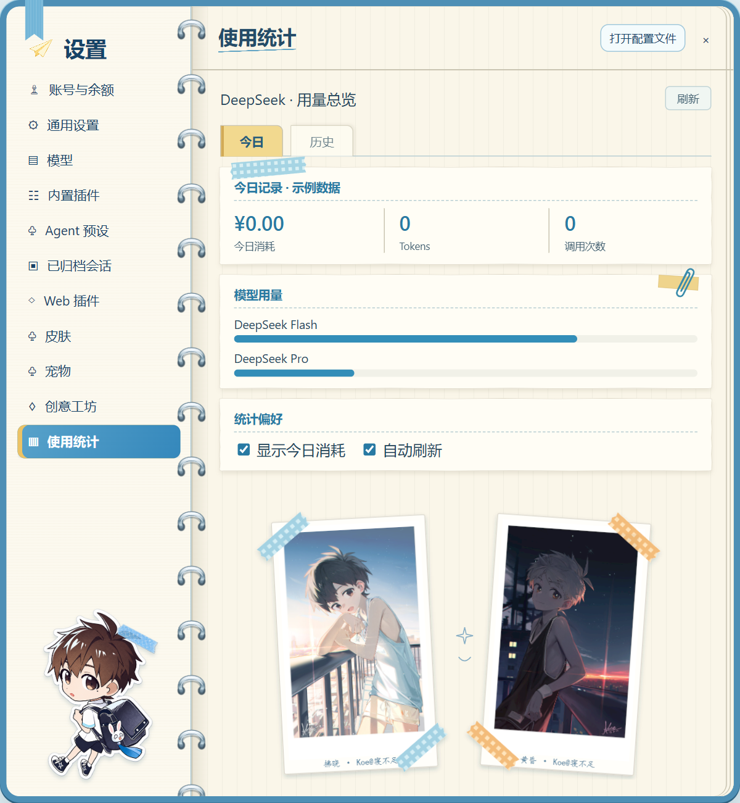
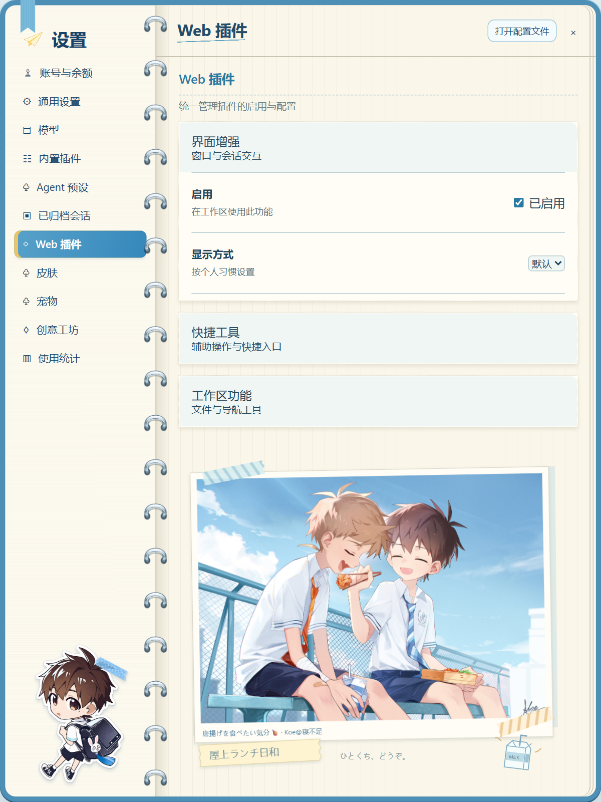

# After-School Squad Journal

**中文** · [English](README.en.md) · [日本語](README.ja.md)

### 放課後小队手账本

**把放课后的好时光，收进每一页。**

> **授权确认中 · 给画师的设计展示**

这是为方便 **Koe@寝不足** 老师查看插画使用方式而整理的 DeepSeek Harness 手账皮肤展示稿。蓝色方格纸、活页环、纸签与胶带，把会话和设置页面装订成一本手账。

当前为个人非商业设计原型，插画使用授权尚未确认。仓库提供效果图、介绍与作品来源；完整皮肤、安装包和独立原画素材暂未发布。本项目不是画师或 DeepSeek 的官方合作项目。

## 01 · 主界面

《UNOタイム》作为相纸中的主画面。会话列表像一张张档案卡，输入框是一张蓝色方格便签，用纸签、胶带和叠纸边缘连接起来。

> 主界面由当前皮肤样式与演示布局重建；会话、账号和用量均为展示数据。

## 02 · 设置页里的日常

插画放在设置内容下方，与导航、表单和手账装饰一起呈现。点击截图可查看大图。

> 这些是使用现有皮肤样式和代表性设置控件重建的模拟页面。为同时展示控件与底部插画，截图纵向展开了原本需要滚动的内容；不是运行中应用的原样截屏。截图中的界面文字保留中文。

<table>
<tr>
<td width="50%" valign="top">
<h3>通用设置</h3>

冰蓝相纸、雪花与围巾。

</td>
<td width="50%" valign="top">
<h3>模型</h3>

绿色胶带、西瓜与种子袋。

</td>
</tr>
<tr>
<td width="50%" valign="top">
<h3>内置插件</h3>

红格餐布、菜单与碗筷。

</td>
<td width="50%" valign="top">
<h3>Agent 预设</h3>

星轨、信封与金色封签。

</td>
</tr>
<tr>
<td width="50%" valign="top">
<h3>已归档会话</h3>

夜色胶带、烟火与夏祭票根。

</td>
<td width="50%" valign="top">
<h3>宠物</h3>

回形针、蓝色纸签与柠檬汽水。

</td>
</tr>
<tr>
<td width="50%" valign="top">
<h3>账号与余额</h3>

电影合照、票根与「放課後記錄」纸签。

</td>
<td width="50%" valign="top">
<h3>使用统计</h3>

拂晓与黄昏双照片，搭配蓝橙格纹胶带。

</td>
</tr>
<tr>
<td width="50%" valign="top">
<h3>Web 插件</h3>

浅蓝与橙色条纹胶带、午餐纸签和牛奶盒涂鸦。

</td>
<td></td>
</tr>
</table>

作者与作品名标在照片白边，完整原作见下方链接。

## 插画与制作说明

页面中的插画与左下角 Q 版人物贴纸均为 **Koe@寝不足** 的作品。插画来源见下表（来自 P 站及画师 X 原帖），[画师主页](https://www.pixiv.net/users/3063728/artworks)；Q 版贴纸来源为画师的[哔哩哔哩动态](https://www.bilibili.com/opus/938087270536183840)。纸张、胶带、界面图标及汽水等周边装饰由本项目制作，部分使用 AI 辅助生成，并非画师原作的一部分。

| 展示位置 | 原作 |
| --- | --- |
| 主界面 | [UNOタイム](https://www.pixiv.net/artworks/121190180) |
| 通用设置 | [雪合戦❄](https://www.pixiv.net/artworks/139476242) |
| 模型 | [夏が懐かしくなった](https://www.pixiv.net/artworks/118909853) |
| 内置插件 | [すき焼きタイム](https://www.pixiv.net/artworks/118880991) |
| Agent 预设 | [星の手紙🌟](https://www.pixiv.net/artworks/118816328) |
| 已归档会话 | [夏が終わる前に](https://www.pixiv.net/artworks/139476059) |
| 宠物 | [夏の気配](https://www.pixiv.net/artworks/98313271) |
| 账号与余额 | [シネマ🎬](https://x.com/Koe_Nemu/status/1793287183694217506) |
| 使用统计 | [栏杆双图（展示标签：拂晓／黄昏）](https://x.com/Koe_Nemu/status/1793653257379950875) |
| Web 插件 | [唐揚げを食べたい気分🍗](https://x.com/Koe_Nemu/status/1792194921761579318/photo/1) |
| 设置页左下角 | [Q 版人物贴纸](https://www.bilibili.com/opus/938087270536183840) |

## 授权状态

插画权利归原作者及相应权利人所有。公开展示和署名不代表已经获得插画使用或再分发授权，也不向查看者授予插画使用许可。完整皮肤发布需另行确认授权范围。

**中文** · [English](README.en.md) · [日本語](README.ja.md)

展示整理：**[Alphazerolan](https://github.com/Alphazerolan)** · 2026-10-17
